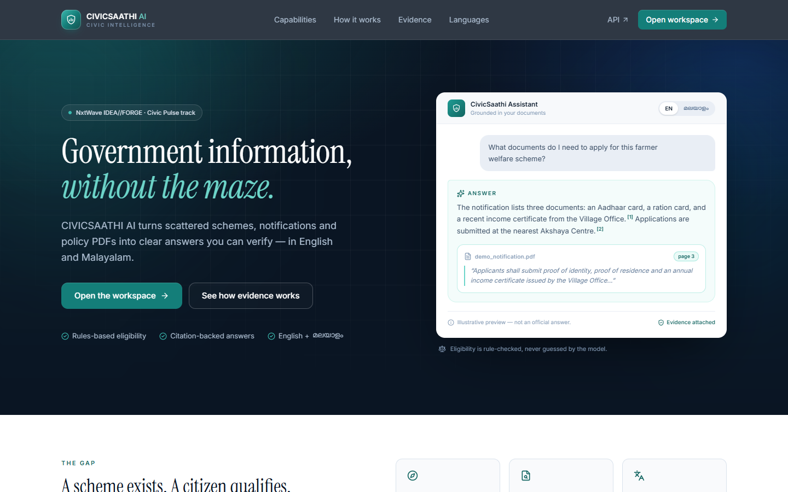
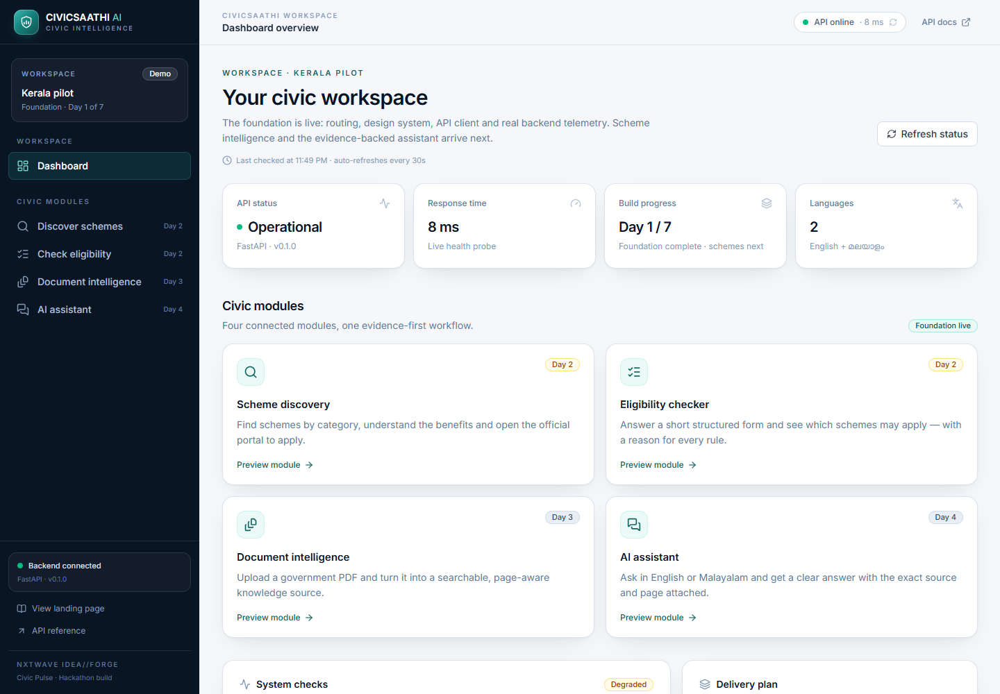
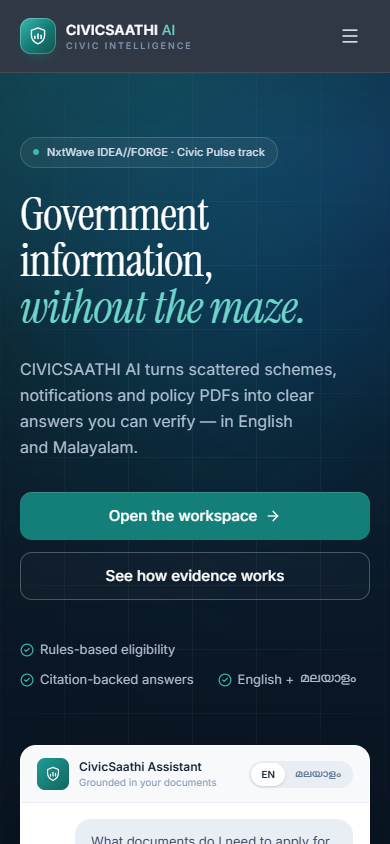

# CIVICSAATHI AI

**Government information, without the maze.**

A multilingual civic intelligence assistant for Kerala. CIVICSAATHI AI turns
scattered government schemes, eligibility rules and official notification PDFs
into clear English and Malayalam answers that a citizen can verify.

> **Build status: Day 1 of 7 complete.** The foundation, landing page,
> workspace dashboard and live FastAPI connection are working. Scheme
> discovery, eligibility, document intelligence and the RAG assistant are
> clearly marked as upcoming rather than shipped as mocks.

Built for **NxtWave IDEA//FORGE — Civic Pulse track**.



## The problem

A scheme can exist, a citizen can qualify, and the information can still be
unreachable. Notifications are long, portals are fragmented, and eligibility
language is hard to translate into a decision. Most AI demos make this worse by
guessing.

CIVICSAATHI AI takes the opposite approach:

- **Rules decide eligibility**, not a language model.
- **Official sources only** — no invented schemes, benefits or links.
- **Answers carry evidence** — document name, page number and excerpt.
- **Missing evidence is stated**, never filled in with a plausible guess.
- **English and Malayalam** are treated as first-class languages.

## What works today

| Area | Day 1 state |
| --- | --- |
| Marketing site | Responsive landing page with bilingual answer preview, problem framing, workflow and trust sections |
| Workspace | Dashboard shell, sidebar, mobile drawer, module previews, 404 page |
| Live telemetry | API status, response time, readiness checks and product metadata polled every 30 seconds |
| Backend | FastAPI app with typed settings, CORS, logging, lifespan state and a consistent error envelope |
| Data layer | Read-only JSON scheme repository with an intentionally empty, valid dataset |
| Failure states | Loading skeletons, offline banner, retry action and stale-data handling |
| Quality | 5 backend tests passing; Ruff clean; Oxlint clean; production frontend build succeeds |

The four civic modules have polished preview pages with honest "Day 2/3/4"
labels. They do not pretend to be functional yet.

## Screenshots

| Landing page | Workspace dashboard |
| :---: | :---: |
| [](docs/screenshots/landing-desktop.png) | [](docs/screenshots/dashboard-desktop.png) |

<details>
<summary>Mobile views (390 px)</summary>

| Landing page | Workspace dashboard |
| :---: | :---: |
|  |  |

</details>

## Architecture

```text
┌─────────────────────────────────────────────────────────────┐
│ Browser                                                     │
│ React 19 · Vite 8 · Tailwind CSS 4 · React Router 7         │
│                                                             │
│  Landing page          Workspace shell                      │
│  /                     /app                                 │
│                        ├── /app/schemes       (Day 2)       │
│                        ├── /app/eligibility   (Day 2)       │
│                        ├── /app/documents     (Day 3)       │
│                        └── /app/assistant     (Day 4)       │
│                                                             │
│  Axios client · 12 s timeout · error normalization          │
│  30 s polling · loading / offline / stale states            │
└───────────────────────────┬─────────────────────────────────┘
                            │ JSON over HTTP
┌───────────────────────────▼─────────────────────────────────┐
│ FastAPI  ·  /api/v1                                         │
│                                                             │
│  GET /health                 liveness, no dependencies       │
│  GET /health/readiness       dataset, DB, AI, vector store   │
│  GET /system/info            languages, features, disclaimer │
│                                                             │
│  routes  →  services  →  repository / future integrations    │
│                                                             │
│  core/config.py  ←  backend/.env  (server-side secrets)      │
└───────────────────────────┬─────────────────────────────────┘
                            │
              ┌─────────────▼──────────────┐
              │ data/sample_schemes/       │
              │ schemes.json (empty today) │
              └────────────────────────────┘
```

Planned additions: Supabase PostgreSQL (Day 2), deterministic eligibility rules
(Day 2), PyMuPDF + ChromaDB ingestion (Day 3), Gemini RAG with page citations
(Day 4), bilingual polish and evaluation (Day 5–6), deployment (Day 7).

Read the full design in [`docs/ARCHITECTURE.md`](docs/ARCHITECTURE.md).

## Tech stack

| Layer | Choice |
| --- | --- |
| Frontend | React 19, Vite 8, JavaScript, Tailwind CSS 4, React Router 7, Axios, Lucide |
| Backend | Python 3.12, FastAPI, Pydantic 2, pydantic-settings, Uvicorn |
| Data (Day 1) | Validated JSON repository |
| Data (planned) | Supabase PostgreSQL, ChromaDB |
| AI (planned) | Google Gemini, evidence-first RAG |
| Documents (planned) | PyMuPDF, semantic chunking, embeddings |
| Deployment (planned) | Vercel (frontend), Render (backend) |

## Repository layout

```text
CIVICSAATHI-AI/
├── backend/
│   ├── app/
│   │   ├── core/                  # settings + logging
│   │   ├── database/              # scheme repository adapter
│   │   ├── models/                # Pydantic response contracts
│   │   ├── routes/                # health, readiness, system info
│   │   ├── services/              # business logic and feature registry
│   │   └── main.py                # FastAPI entrypoint
│   ├── tests/                     # 5 API tests
│   ├── requirements.txt
│   ├── requirements-dev.txt
│   └── README.md
├── frontend/
│   ├── src/
│   │   ├── components/            # layout, marketing, UI, brand
│   │   ├── data/modules.js        # module and feature copy
│   │   ├── hooks/                 # snapshot polling
│   │   ├── pages/                 # landing, dashboard, previews, 404
│   │   ├── services/api.js        # Axios client and error normalization
│   │   └── index.css              # design tokens and motion rules
│   ├── public/
│   └── README.md
├── data/sample_schemes/
│   ├── schemes.json               # intentionally empty on Day 1
│   └── README.md                  # official-source data policy
├── docs/
│   ├── ARCHITECTURE.md
│   └── screenshots/
└── README.md
```

## Quick start

### Prerequisites

- Node.js 20+ and npm
- Python 3.12
- Two terminals (API + web app)

### 1. Backend

```powershell
cd backend
py -3.12 -m venv .venv
.\.venv\Scripts\Activate.ps1
python -m pip install --upgrade pip
pip install -r requirements-dev.txt
Copy-Item .env.example .env
python -m uvicorn app.main:app --reload --host 127.0.0.1 --port 8000
```

macOS/Linux:

```bash
cd backend
python3.12 -m venv .venv
source .venv/bin/activate
python -m pip install --upgrade pip
pip install -r requirements-dev.txt
cp .env.example .env
python -m uvicorn app.main:app --reload --host 127.0.0.1 --port 8000
```

If PowerShell blocks activation, run
`.\.venv\Scripts\python.exe -m uvicorn app.main:app --reload --port 8000`
directly from `backend/`.

### 2. Frontend

In a second terminal:

```powershell
cd frontend
npm install
Copy-Item .env.example .env.local   # optional; defaults to port 8000
npm run dev
```

Open <http://localhost:5173>. The dashboard polls the API and shows an honest
offline state if the backend is not running.

### 3. Verify

| URL | Expected |
| --- | --- |
| <http://localhost:5173> | Landing page |
| <http://localhost:5173/app> | Workspace dashboard with live API telemetry |
| <http://127.0.0.1:8000/docs> | Swagger UI |
| <http://127.0.0.1:8000/api/v1/health> | `{"status":"ok", ...}` |
| <http://127.0.0.1:8000/api/v1/health/readiness> | `degraded` on Day 1, with per-dependency reasons |

Readiness is expected to be `degraded` right now: the dataset is empty and the
AI/database dependencies are scheduled for later days. That is a truthful
signal, not a failure.

## Configuration

Backend variables live in `backend/.env` (copied from `.env.example`).
Frontend variables live in `frontend/.env.local` (copied from `.env.example`).

| Variable | Scope | Notes |
| --- | --- | --- |
| `ENVIRONMENT` | Backend | `development`, `staging`, `production` |
| `LOG_LEVEL` | Backend | Defaults to `INFO` |
| `CORS_ORIGINS` | Backend | Comma-separated allowed origins |
| `GEMINI_API_KEY` | Backend | Server-side only; never expose in the browser |
| `GEMINI_MODEL` | Backend | Defaults to `gemini-2.5-flash` |
| `SUPABASE_URL` | Backend | Day 2 integration |
| `SUPABASE_SERVICE_ROLE_KEY` | Backend | Server-only; never ship to the client |
| `CHROMA_PERSIST_DIR` | Backend | Defaults to `backend/.chroma` |
| `VITE_API_BASE_URL` | Frontend | Public API origin; defaults to `http://127.0.0.1:8000` |

`VITE_*` values are embedded in the browser bundle. Only public configuration
belongs there. All secrets stay in the backend environment.

## API

| Method | Endpoint | Description |
| --- | --- | --- |
| `GET` | `/` | Service name, version and docs link |
| `GET` | `/api/v1/health` | Liveness and uptime |
| `GET` | `/api/v1/health/readiness` | Dependency state with human-readable details |
| `GET` | `/api/v1/system/info` | Product metadata, languages and feature registry |

```json
{
  "status": "ok",
  "service": "civicsaathi-api",
  "version": "0.1.0",
  "environment": "development",
  "timestamp": "2026-11-15T18:15:28Z",
  "uptime_seconds": 6.07
}
```

Planned contracts (documented in the UI previews):

- `GET /api/v1/schemes` and `GET /api/v1/schemes/{id}`
- `POST /api/v1/eligibility/check`
- `POST /api/v1/documents` and `GET /api/v1/documents/{id}`
- `POST /api/v1/assistant/query`

## Trust and safety rules

1. **Deterministic eligibility.** The language model may explain a result; it
   never produces the result. Rule evaluation lives in backend code.
2. **Official sources only.** Every scheme record must link to a government
   portal and carry a verification date.
3. **No fabricated data.** An empty dataset is reported as `pending`, not
   filled with invented schemes.
4. **Evidence or nothing.** Document answers must cite a file and page, or say
   the evidence was not found.
5. **Demo content is labelled.** Illustrative UI content says so explicitly.
6. **Secrets stay server-side.** No API key is bundled, logged or committed.

## Quality checks

```powershell
# Backend
cd backend
.\.venv\Scripts\python.exe -m pytest
.\.venv\Scripts\python.exe -m ruff check .

# Frontend
cd frontend
npm run lint
npm run build
```

Current Day 1 result: **5/5 backend tests pass**, Ruff clean, Oxlint clean and
the Vite production build completes. Screenshots were verified at 1440 px and
390 px with zero horizontal overflow.

## Roadmap

| Day | Milestone | Outcome |
| --- | --- | --- |
| 1 | Foundation | Design system, routes, live API contract, health telemetry |
| 2 | Schemes & eligibility | Curated source-linked catalogue, search, deterministic rules engine |
| 3 | Document intelligence | PDF upload, extraction, chunking, embeddings, ChromaDB retrieval |
| 4 | Evidence-backed assistant | Gemini RAG in English and Malayalam with page citations |
| 5 | Bilingual journey | Full Malayalam interface and end-to-end UX polish |
| 6 | Hardening | Evaluation set, failure-mode tests, accessibility and performance |
| 7 | Deploy & demo | Vercel + Render deployment, demo script, submission assets |

## Deployment notes

The project is not deployed yet. When it is:

- **Frontend (Vercel):** root `frontend`, build `npm run build`, output `dist`,
  environment `VITE_API_BASE_URL=https://<backend-host>`. Configure an SPA
  rewrite to `index.html` if the host does not handle client-side routes.
- **Backend (Render):** root `backend`, Python 3.12, build
  `pip install -r requirements.txt`, start
  `uvicorn app.main:app --host 0.0.0.0 --port $PORT`, environment
  `ENVIRONMENT=production` and the relevant secrets.
- Update `CORS_ORIGINS` on the backend to the deployed frontend origin.

## Disclaimer

CIVICSAATHI AI is a hackathon prototype and is not an official Government of
Kerala service. Always verify scheme details on the official portal linked in
each record. The illustrative answer card on the landing page is demo content,
not an official answer.
