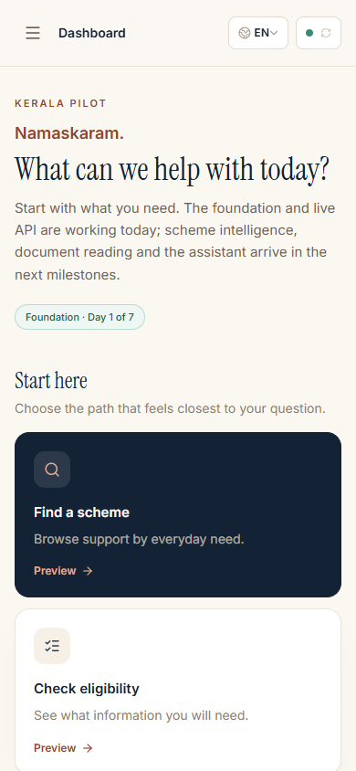

# CIVICSAATHI AI

**Government information, without the maze.**

A multilingual civic intelligence assistant for Kerala. CIVICSAATHI AI turns
scattered government schemes, eligibility rules and official notification PDFs
into clear, verifiable guidance in English, Malayalam or Hindi.

> **Build status: Day 4 of 7 complete.** The foundation, live telemetry, a
> corrected and re-verified 15-scheme catalogue, a deterministic eligibility
> engine, a live document-intelligence pipeline and an evidence-grounded
> multilingual assistant are wired end to end. Automated tests mock Gemini by
> default; a live Gemini call is a separate opt-in check, not a default test.

Built for **NxtWave IDEA//FORGE — Civic Pulse track**.


## The problem

A scheme can exist, a citizen can qualify, and the information can still be
unreachable. Notifications are long, portals are fragmented, and eligibility
language is hard to translate into a decision. Most AI demos make this worse by
guessing.

CIVICSAATHI AI takes the opposite approach:

- **Rules decide eligibility**, not a language model.
- **Official sources only** — no invented schemes, benefits or links.
- **Every scheme carries provenance** — a source URL and a verification date.
- **Every document passage carries its page number** — no answer without a source.
- **Missing evidence is stated**, never filled in with a plausible guess.
- **English, Malayalam and Hindi** are treated as first-class languages.

## What works today

| Area | Day 4 state |
| --- | --- |
| Marketing site | Responsive landing page with trilingual answer preview, problem framing, workflow and trust sections |
| Workspace | Dashboard shell, sidebar, mobile drawer, live module labels, 404 page |
| Scheme catalogue | Search, nine category filters, central/state filters, pagination, loading/empty/error states |
| Scheme detail | Full verified record with benefits, documents, steps, conditions and official sources |
| Eligibility | Optional 34-field form, tri-state answers, deterministic results and per-condition explanations |
| Data layer | 15 curated schemes, 53 reusable conditions (44 profile, 9 manual), all source-linked and validated by Pydantic |
| Document intelligence | Secure PDF upload, PyMuPDF extraction, page-aware overlapping chunks, multilingual embeddings, persistent ChromaDB search with page citations |
| Backend | FastAPI app with typed settings, CORS, logging, lifespan state, threadpool document work and consistent error envelopes |
| Assistant | Gemini-backed answers grounded in retrieved passages, EN/ML/HI output, validated backend citations and honest insufficient-evidence states |
| Failure states | Skeletons, offline banner, retry actions, 404 handling, upload progress, assistant timeout/error states and stale-data protection |
| Quality | 229 backend tests passing (2 gated), 9 frontend tests, Ruff/Oxlint clean, production frontend build succeeds |

Document intelligence is live in English, Malayalam and Hindi. The assistant is
also live in all three languages once `GEMINI_API_KEY` is configured: it retrieves
first, answers only from that evidence, and says when the documents do not contain
the answer. Without a key, `/api/v1/assistant/ask` returns a safe `503` while
document search keeps working. See [`docs/DAY_4_GEMINI.md`](docs/DAY_4_GEMINI.md).

## Screenshots

| Landing page | Workspace dashboard |
| :---: | :---: |
| [](docs/screenshots/landing-desktop.png) | [](docs/screenshots/dashboard-desktop.png) |

These screenshots show the foundation shell. The live catalogue, eligibility and
document pages are available at `/app/schemes`, `/app/eligibility` and
`/app/documents`.

<details>
<summary>Mobile views (390 px)</summary>

| Landing page | Workspace dashboard |
| :---: | :---: |
|  |  |

</details>

## Architecture

```text
┌─────────────────────────────────────────────────────────────────┐
│ Browser                                                         │
│ React 19 · Vite 8 · Tailwind CSS 4 · React Router 7             │
│                                                                 │
│  Landing page          Workspace shell                          │
│  /                     /app                                     │
│                        ├── /app/schemes          (live)         │
│                        ├── /app/schemes/:id      (live)         │
│                        ├── /app/eligibility      (live)         │
│                        ├── /app/documents        (live)         │
│                        └── /app/assistant        (live)         │
│                                                                 │
│  Axios client · cancellation · error normalization              │
│  30 s polling · loading / empty / offline / stale states        │
└───────────────────────────┬─────────────────────────────────────┘
                            │ JSON over HTTP
┌───────────────────────────▼─────────────────────────────────────┐
│ FastAPI  ·  /api/v1                                             │
│                                                                 │
│  GET  /health                liveness, no dependencies          │
│  GET  /health/readiness      dataset, DB, AI, vector store      │
│  GET  /system/info           languages, features, disclaimer    │
│  GET  /schemes               search · filter · pagination       │
│  GET  /schemes/{id}          verified detail record             │
│  POST /eligibility/check     in-memory deterministic rules      │
│  POST /documents/upload      validate + index a PDF             │
│  GET  /documents             library with status                │
│  GET  /documents/{id}        document metadata                  │
│  POST /documents/search      page-cited passages                │
│  DELETE /documents/{id}      scoped document deletion           │
│  POST /assistant/ask          grounded answer + citations        │
│                                                                 │
│  routes → services → repository / store                         │
│  assistant_service.py        retrieval → evidence → validation  │
│  core/source_policy.py       HTTPS official-source allowlist    │
│  core/config.py              server-side secrets only           │
└──────────────┬─────────────────────────────┬─────────────────────┘
               │                             │
 ┌─────────────▼──────────────┐  ┌───────────▼────────────────────────┐
 │ data/sample_schemes/       │  │ backend/data/documents/ + .chroma  │
 │ schemes.json               │  │ PDFs, JSON registry, ChromaDB      │
 │ 15 schemes · 53 conditions │  │ multilingual-e5-small embeddings   │
 └────────────────────────────┘  └───────────────┬────────────────────┘
                                                 │ bounded passages
                                 ┌───────────────▼────────────────────┐
                                 │ Google Gemini (server-side key)    │
                                 │ structured JSON · evidence ids only│
                                 └────────────────────────────────────┘
```

### Document pipeline (Day 3)

```text
PDF bytes → content validation → PyMuPDF text per page → page-aware chunks
          → "passage: " multilingual-e5-small embeddings → ChromaDB (cosine)
query     → "query: " embedding → nearest passages → page + filename citations
```

- **Secure upload:** real PDF header and parse check, 10 MB / 100 page caps,
  encrypted/corrupt/empty PDFs rejected, safe display names, generated UUID
  storage names, no path traversal, no PDF script execution.
- **Page-aware chunks:** ~1200 characters with 200-character overlap, paragraph
  and sentence boundaries respected, tiny fragments merged, empty pages skipped,
  Unicode (Malayalam/Hindi) preserved exactly. Every chunk records its page.
- **Persistent store:** JSON registry plus ChromaDB collection
  `civicsaathi_government_documents`; SHA-256 deduplication; reopen-safe;
  deletion scoped to one `document_id`.
- **Honest retrieval:** `top_k` bounded (1–20), optional document filter,
  explicit no-relevant-evidence response, and a notice that similarity is not
  proof of correctness. Document search itself never generates an answer.

### Assistant pipeline (Day 4)

```text
question → validation → language + optional document filter
         → multilingual retrieval → evidence quality gate
         → bounded Gemini prompt → strict JSON parsing
         → evidence-id validation → backend-built citations → response
```

- **No evidence, no model call.** Insufficient retrieval returns a localized
  no-answer response immediately.
- **Untrusted passages.** Embedded instructions in PDF text never change the
  assistant's rules; the system instruction forbids secret disclosure, invented
  facts and eligibility decisions.
- **Backend-owned citations.** Gemini returns only `evidence_id` values. Titles,
  ids, pages and excerpts come from the retrieved passage; fabricated ids are
  discarded and a single corrective retry is allowed.
- **Bounded by design.** Retrieval, context characters and output tokens are
  capped; the request has a timeout and errors map to safe `detail`/`code`
  envelopes. Nothing is persisted.

Remaining milestones: trilingual evaluation and polish (Day 5–6), deployment
(Day 7). Supabase persistence is deferred;
the validated JSON repository and ChromaDB store are the active providers and
the seams for a future database.

Read the grounded-generation design in
[`docs/DAY_4_GEMINI.md`](docs/DAY_4_GEMINI.md), the full design in
[`docs/ARCHITECTURE.md`](docs/ARCHITECTURE.md) and the
dataset policy in
[`data/sample_schemes/README.md`](data/sample_schemes/README.md).

## Tech stack

| Layer | Choice |
| --- | --- |
| Frontend | React 19, Vite 8, JavaScript, Tailwind CSS 4, React Router 7, Axios, Lucide |
| Backend | Python 3.12, FastAPI, Pydantic 2, pydantic-settings, Uvicorn |
| Data (Day 2) | Validated JSON repository with 15 curated schemes |
| Data (deferred) | Supabase PostgreSQL |
| Eligibility | Pure-Python three-valued rule evaluator, data-driven DNF rules |
| Documents (Day 3) | PyMuPDF, sentence-transformers `intfloat/multilingual-e5-small`, ChromaDB, python-multipart |
| AI (Day 4) | Official `google-genai` SDK, evidence-first RAG, structured JSON output |
| Deployment (planned) | Vercel (frontend), Render (backend) |

## Repository layout

```text
CIVICSAATHI-AI/
├── backend/
│   ├── app/
│   │   ├── core/                  # settings, logging, source allowlist
│   │   ├── database/              # scheme repository, document store + ChromaDB
│   │   ├── models/                # Pydantic API, dataset and document contracts
│   │   ├── routes/                # health, system, schemes, eligibility, documents, assistant
│   │   ├── services/              # rules, readiness, document pipeline, Gemini, assistant RAG
│   │   └── main.py                # FastAPI entrypoint
│   ├── tests/                     # 229 unit/API tests + gated integration tests
│   ├── requirements.txt
│   ├── requirements-dev.txt
│   └── README.md
├── frontend/
│   ├── src/
│   │   ├── components/            # layout, marketing, UI, brand
│   │   ├── data/modules.js        # module status and feature copy
│   │   ├── hooks/                 # snapshot polling
│   │   ├── i18n/                  # EN/ML/HI catalogs
│   │   ├── lib/                   # class and formatting helpers
│   │   ├── pages/                 # landing, dashboard, schemes, eligibility, documents, assistant
│   │   ├── services/api.js        # Axios client and error normalization
│   │   └── index.css              # design tokens and motion rules
│   ├── public/
│   └── README.md
├── data/sample_schemes/
│   ├── schemes.json               # 15 verified schemes and 53 conditions
│   └── README.md                  # dataset, rule and source policy
├── docs/
│   ├── ARCHITECTURE.md
│   ├── DAY_4_GEMINI.md
│   └── screenshots/
└── README.md
```

## Quick start

### Prerequisites

- Node.js 20+ and npm
- Python 3.12
- Two terminals (API + web app)
- ~130 MB disk for the multilingual embedding model (downloaded on first use)

### 1. Backend

```powershell
cd backend
py -3.12 -m venv .venv
.\.venv\Scripts\Activate.ps1
python -m pip install --upgrade pip
pip install -r requirements-dev.txt
Copy-Item .env.example .env
python -m uvicorn app.main:app --reload --host 127.0.0.1 --port 8000
```

macOS/Linux:

```bash
cd backend
python3.12 -m venv .venv
source .venv/bin/activate
python -m pip install --upgrade pip
pip install -r requirements-dev.txt
cp .env.example .env
python -m uvicorn app.main:app --reload --host 127.0.0.1 --port 8000
```

If PowerShell blocks activation, run
`.\.venv\Scripts\python.exe -m uvicorn app.main:app --reload --port 8000`
directly from `backend/`. The first document request downloads
`intfloat/multilingual-e5-small` into the Hugging Face cache; pre-warm it with
`python -c "from sentence_transformers import SentenceTransformer; SentenceTransformer('intfloat/multilingual-e5-small')"` if you want the delay to happen at setup time.

### 2. Frontend

In a second terminal:

```powershell
cd frontend
npm install
Copy-Item .env.example .env.local   # optional; defaults to port 8000
npm run dev
```

Open <http://localhost:5173>. The dashboard polls the API and shows an honest
offline state if the backend is not running.

### 3. Verify

| URL | Expected |
| --- | --- |
| <http://localhost:5173/app/schemes> | Verified catalogue with search and filters |
| <http://localhost:5173/app/eligibility> | Optional form and preliminary results |
| <http://localhost:5173/app/documents> | Upload a text-based PDF and search its pages |
| <http://localhost:5173/app/assistant> | Ask a grounded question (requires a configured Gemini key) |
| <http://localhost:5173/app> | Workspace dashboard with live API telemetry |
| <http://127.0.0.1:8000/docs> | Swagger UI |
| <http://127.0.0.1:8000/api/v1/schemes> | 15 curated schemes, paginated |
| <http://127.0.0.1:8000/api/v1/documents> | Empty list before the first upload |
| <http://127.0.0.1:8000/api/v1/health/readiness> | `degraded` while Supabase is unconfigured; dataset, vector store and assistant features are `ok`/`live` |

Readiness remains expectedly `degraded` while Supabase is intentionally
unconfigured. Gemini is reported `ok` only when a key is present; this checks
credential presence, not a live provider response. The assistant feature itself
is registered as `live`. That is a truthful signal, not a failure.

## Configuration

Backend variables live in `backend/.env` (copied from `.env.example`).
Frontend variables live in `frontend/.env.local` (copied from `.env.example`).

| Variable | Scope | Notes |
| --- | --- | --- |
| `ENVIRONMENT` | Backend | `development`, `staging`, `production` |
| `LOG_LEVEL` | Backend | Defaults to `INFO` |
| `CORS_ORIGINS` | Backend | Comma-separated allowed origins |
| `GEMINI_API_KEY` | Backend | Server-side only; empty disables assistant answers |
| `GEMINI_MODEL` | Backend | Defaults to `gemini-2.5-flash` |
| `ASSISTANT_TOP_K` | Backend | Retrieved passages before the quality gate; default `5` |
| `ASSISTANT_MIN_SIMILARITY` | Backend | Heuristic evidence threshold on top of the Day 3 distance gate; default `0.30` |
| `ASSISTANT_MAX_EVIDENCE_CHUNKS` | Backend | Maximum passages sent to Gemini; default `5` |
| `ASSISTANT_MAX_CONTEXT_CHARS` | Backend | Total excerpt budget; default `12000` |
| `ASSISTANT_REQUEST_TIMEOUT_SECONDS` | Backend | Gemini request timeout; default `30` |
| `ASSISTANT_MAX_OUTPUT_TOKENS` | Backend | Generation cap; default `900` |
| `SUPABASE_URL` | Backend | Deferred; JSON repository is active |
| `SUPABASE_SERVICE_ROLE_KEY` | Backend | Server-only; never ship to the client |
| `CHROMA_PERSIST_DIR` | Backend | Defaults to `backend/.chroma` |
| `DOCUMENT_COLLECTION_NAME` | Backend | Defaults to `civicsaathi_government_documents` |
| `DOCUMENT_STORAGE_DIR` | Backend | Server-only PDF storage, defaults to `backend/data/documents` |
| `DOCUMENT_MAX_UPLOAD_BYTES` | Backend | Default 10 MB |
| `DOCUMENT_MAX_PAGES` | Backend | Default 100 |
| `DOCUMENT_CHUNK_CHARS` | Backend | Default 1200 |
| `DOCUMENT_CHUNK_OVERLAP_CHARS` | Backend | Default 200 |
| `DOCUMENT_MIN_CHUNK_CHARS` | Backend | Default 40 |
| `DOCUMENT_OCR_MIN_PAGE_CHARS` | Backend | Default 80; lower text density flags `needs_ocr` |
| `DOCUMENT_SEARCH_TOP_K` | Backend | Default 5 |
| `DOCUMENT_SEARCH_MAX_TOP_K` | Backend | Default 20 |
| `DOCUMENT_SEARCH_MAX_DISTANCE` | Backend | Default 1.0 cosine distance |
| `EMBEDDING_MODEL_NAME` | Backend | Defaults to `intfloat/multilingual-e5-small` |
| `VITE_API_BASE_URL` | Frontend | Public API origin; defaults to `http://127.0.0.1:8000` |

`VITE_*` values are embedded in the browser bundle. Only public configuration
belongs there. All secrets and storage paths stay in the backend environment.

## API

| Method | Endpoint | Description |
| --- | --- | --- |
| `GET` | `/` | Service name, version and docs link |
| `GET` | `/api/v1/health` | Liveness and uptime |
| `GET` | `/api/v1/health/readiness` | Dependency state with human-readable details |
| `GET` | `/api/v1/system/info` | Product metadata, languages and feature registry |
| `GET` | `/api/v1/schemes` | Search, filter and paginate the curated catalogue |
| `GET` | `/api/v1/schemes/{id}` | Full verified scheme record |
| `POST` | `/api/v1/eligibility/check` | Deterministic in-memory eligibility check |
| `POST` | `/api/v1/documents/upload` | Validate, store and index a PDF (201; 200 on duplicate) |
| `GET` | `/api/v1/documents` | List documents with status and passage counts |
| `GET` | `/api/v1/documents/{document_id}` | Full document metadata |
| `POST` | `/api/v1/documents/search` | Retrieve real passages with page citations |
| `DELETE` | `/api/v1/documents/{document_id}` | Delete one document, its file and its vectors |
| `POST` | `/api/v1/assistant/ask` | Grounded answer with validated citations (no history) |

List query parameters: `language`, `q` (max 100 characters), `category`,
`government_level`, `page` and `page_size` (1–50, default 12). An empty result
is a normal `200` with a message, never fabricated data.

```json
{
  "status": "ok",
  "service": "civicsaathi-api",
  "version": "0.2.0",
  "environment": "development",
  "timestamp": "2026-11-17T09:15:28Z",
  "uptime_seconds": 6.07
}
```

Eligibility accepts only allowlisted profile fields and rejects unknown fields.
Every answer is optional; omitted answers remain `unknown`. Responses return
condition statuses and supplied field *names*, never the values. Outcomes are
`potentially_eligible`, `ineligible`, `insufficient_information` or
`manual_review` — never a bare `eligible`.

Document search accepts `query` (1–1000 characters), optional `top_k`
(1–20, default 5) and optional `document_id`. Results are actual indexed
passages with filename and page number; no match returns
`has_evidence: false` with an explicit no-evidence message. Every response notes
that similarity is not proof of factual correctness. Assistant requests accept
`question`, optional `language` (`en`, `ml`, `hi`) and optional `document_id`, and
reject unknown fields such as `system_prompt`. Responses include the answer,
backend-built citations and a localized insufficient-evidence state. There is no
`/assistant/query` endpoint and no history endpoint. See
[`backend/README.md`](backend/README.md) and
[`docs/DAY_4_GEMINI.md`](docs/DAY_4_GEMINI.md) for the full contracts.

## Trust and safety rules

1. **Deterministic eligibility.** The language model never produces the result.
   Rule evaluation is pure Python and lives in the backend.
2. **Official sources only.** Every scheme URL passes an HTTPS allowlist with a
   recorded verification rationale, and every record carries a verification
   date.
3. **No fabricated data.** A missing or invalid dataset returns `503`; an empty
   search returns an honest empty state.
4. **No guessing from silence.** A missing profile answer is `unknown`, not
   `false`. Manual official checks force `manual_review`.
5. **Preliminary language only.** The strongest outcome is
   `potentially_eligible`; final eligibility belongs to the relevant government
   authority.
6. **No profile persistence.** Eligibility answers are evaluated in memory,
   never stored and never written to browser storage.
7. **Evidence or nothing.** Document results are real passages with a file and
   page citation, or say the evidence was not found. Assistant answers are
   generated only from those passages and carry server-built citations.
8. **Secure document handling.** PDFs are validated by content, capped by size
   and pages, never executed, and stored under generated names; no API response
   exposes a server path.
9. **Secrets stay server-side.** No API key is bundled, logged or committed.
10. **Prompt injection is contained.** Retrieved passages are untrusted data;
    embedded instructions cannot change rules or reveal secrets.
11. **No eligibility decisions from the model.** The assistant states document
    conditions; only the deterministic Day 2 engine produces a preliminary
    outcome.

## Quality checks

```powershell
# Backend
cd backend
.\.venv\Scripts\python.exe -m pytest
.\.venv\Scripts\python.exe -m ruff check app tests
.\.venv\Scripts\python.exe -m ruff format --check .

# Gated real-model integration test (after the model is cached)
$env:CIVICSAATHI_RUN_MODEL_TESTS = '1'
.\.venv\Scripts\python.exe -m pytest tests/integration -q

# Opt-in LIVE Gemini test (spends a real API call; never needed by default)
$env:CIVICSAATHI_RUN_GEMINI_TESTS = '1'
.\.venv\Scripts\python.exe -m pytest tests/integration/test_gemini_integration.py -q

# Frontend
cd frontend
npm run lint
npm test
npm run build
```

Current Day 4 result: **229 backend tests pass** with 2 gated integration
tests skipped, **9 frontend tests pass**, Ruff and Oxlint are clean and the Vite
production build completes. Gemini is mocked in the default suite; the live test
is opt-in and no prompt, answer or key is logged. Screenshots of the Day 1/2
shell were verified at 1440 px and 390 px in all three languages with zero
horizontal overflow.

## Roadmap

| Day | Milestone | Outcome |
| --- | --- | --- |
| 1 | Foundation | Design system, routes, live API contract, health telemetry |
| 2 | Schemes & eligibility | 15-scheme verified catalogue, search and deterministic rules engine |
| 3 | Document intelligence | PDF upload/extraction, page-aware chunking, multilingual embeddings, ChromaDB retrieval with page citations |
| 4 | Evidence-backed assistant | Complete: Gemini RAG in EN/ML/HI with validated page citations |
| 5 | Trilingual journey | Full English, Malayalam and Hindi experience and end-to-end UX polish |
| 6 | Hardening | Evaluation set, failure-mode tests, accessibility and performance |
| 7 | Deploy & demo | Vercel + Render deployment, demo script, submission assets |

## Deployment notes

The project is not deployed yet. When it is:

- **Frontend (Vercel):** root `frontend`, build `npm run build`, output `dist`,
  environment `VITE_API_BASE_URL=https://<backend-host>`. Configure an SPA
  rewrite to `index.html` if the host does not handle client-side routes.
- **Backend (Render):** root `backend`, Python 3.12, build
  `pip install -r requirements.txt`, start
  `uvicorn app.main:app --host 0.0.0.0 --port $PORT`, environment
  `ENVIRONMENT=production` and the relevant secrets.
- Update `CORS_ORIGINS` on the backend to the deployed frontend origin.
- Mount a persistent disk for `CHROMA_PERSIST_DIR` and `DOCUMENT_STORAGE_DIR`
  (or replace ChromaDB with a managed vector store); allow time and disk for the
  embedding model on first boot.
- Set `GEMINI_API_KEY` and, if needed, `GEMINI_MODEL` as backend environment
  secrets. Never add them to `VITE_*` variables or the browser bundle.

## Disclaimer

CIVICSAATHI AI is a hackathon prototype and is not an official Government of
Kerala service. Always verify scheme details on the official portal linked in
each record. Eligibility results are preliminary and rule-based; final
eligibility is determined by the relevant government authority. Document search
returns source passages, not verified advice — check the official notice.
Generated assistant answers are grounded in uploaded documents but may be
incomplete; verify every detail on the cited page and the official source. The
illustrative answer card on the landing page is demo content, not an official
answer.
