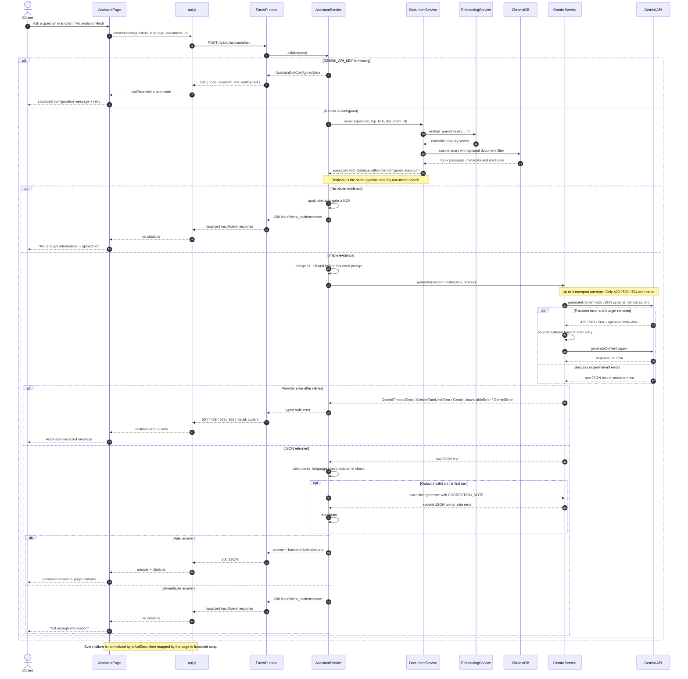

# CIVICSAATHI AI — System Architecture

**Baseline:** commit `4288454` — “Improve Gemini reliability and assistant error handling”
**Status:** local hackathon prototype. **Not deployed.** Live Gemini generation was not verified in the last recorded live check. Supabase is **not** integrated.
**Scope:** derived from the code in this repository, not from planning documents.

This document describes the system that actually runs: the React/Vite browser
application, the FastAPI service, the deterministic eligibility engine, the PDF
ingestion and retrieval pipeline, the ChromaDB stores, and the evidence-grounded
Gemini assistant. Every component below can be traced to a file in the repository.

**Companion diagrams**

- [`architecture.mmd`](architecture.mmd) — main component and data-flow diagram.
- [`assistant-sequence.mmd`](assistant-sequence.mmd) — sequence diagram for one
  evidence-grounded assistant request.

**Legend used in the diagram**

| Visual | Meaning |
| --- | --- |
| Solid border, blue/teal/amber | Implemented application component |
| Cylinder shape, green | Persistent storage on the server |
| Purple | Third-party external dependency |
| Dashed grey border | Planned or deferred; not part of the running system |

No secret, API key, prompt, document passage or stack trace is reproduced here.

---

## 1. Project overview

CIVICSAATHI AI is a trilingual civic-information workspace for Kerala. It
combines five capabilities in one product:

1. **Scheme discovery** — search a curated catalogue of 15 central and Kerala
   schemes by name, department, keyword, category and government level.
2. **Scheme detail** — read benefits, required documents, application steps,
   encoded conditions and official sources with a verification date.
3. **Deterministic eligibility** — evaluate optional profile answers against
   explicit rules and explain every condition.
4. **Document intelligence** — validate and index an official PDF, then retrieve
   real passages with filename and page number.
5. **Evidence-grounded assistant** — retrieve passages first, ask Gemini for an
   answer constrained to those passages, and rebuild every citation on the
   server.

The design separates **rules**, **retrieval** and **generation**. The language
model may explain retrieved text; it never decides eligibility and never supplies
citation metadata.

### Implemented versus planned

| Area | State |
| --- | --- |
| React/Vite frontend, FastAPI API, scheme catalogue, eligibility, PDF pipeline, ChromaDB, Gemini assistant | **Implemented** |
| Google Gemini API | **External service**, called only when a document question has viable evidence |
| `intfloat/multilingual-e5-small` embeddings | **Third-party model**, loaded and executed in-process |
| Supabase PostgreSQL | **Deferred**; the validated JSON repository is the active provider |
| Render/Vercel deployment | **Prepared only**; no live deployment exists |
| Accounts, persistent chat history, OCR, voice, agents | **Not implemented** |

---

## 2. High-level architecture

```mermaid
flowchart TB
%% CIVICSAATHI AI — implemented system architecture.
%% Baseline: commit 4288454. Local development only; not deployed.
%% Solid borders = implemented. Dashed borders = planned/deferred.
%% Cylinder shapes = persistent storage. Purple = third-party external dependency.
  classDef user fill:#0f172a,stroke:#0f172a,color:#ffffff
  classDef frontend fill:#e0f2fe,stroke:#0369a1,color:#0c4a6e
  classDef client fill:#f0fdfa,stroke:#0f766e,color:#134e4a
  classDef backend fill:#fef3c7,stroke:#b45309,color:#78350f
  classDef validation fill:#ffe4e6,stroke:#be123c,color:#881337
  classDef external fill:#fae8ff,stroke:#a21caf,color:#701a75
  classDef storage fill:#dcfce7,stroke:#15803d,color:#14532d
  classDef deferred fill:#f1f5f9,stroke:#64748b,color:#334155,stroke-dasharray: 6 4

  subgraph USER["1 · User interaction"]
    CIT["Citizen<br/>English · Malayalam · Hindi<br/>desktop and mobile browser"]:::user
  end

  subgraph FRONT["2 · React + Vite frontend — implemented · local only"]
    ROUTES["React Router 7<br/>landing · dashboard · schemes · detail<br/>eligibility · documents · assistant"]:::frontend
    I18N["LanguageProvider<br/>EN / ML / HI catalogs<br/>language preference in localStorage"]:::frontend
    SHELL["AppShell snapshot<br/>health + readiness + system info<br/>30 s poll while the tab is visible"]:::frontend
  end

  subgraph CLIENT["3 · API service layer — browser"]
    APIL["Axios service<br/>VITE_API_BASE_URL · no localhost fallback<br/>12 s default · 300 s assistant timeout<br/>cancellation · normalized ApiError"]:::client
  end

  subgraph BACK["4 · FastAPI backend — implemented · local only"]
    ROUTER["HTTP routes under /api/v1<br/>health · system · schemes · eligibility<br/>documents · assistant"]:::backend
    HANDLERS["Typed error handlers<br/>422 validation · 503 dataset<br/>PDF / document / assistant envelopes"]:::validation

    subgraph DOMAIN["5 · Scheme discovery + deterministic eligibility"]
      SCHEME["SchemeService<br/>localized list + detail"]:::backend
      ELIG["EligibilityService<br/>evaluate every curated scheme"]:::backend
      ENGINE["Three-valued rules engine<br/>pass · fail · unknown<br/>DNF: any_of groups of all_of"]:::backend
    end

    subgraph INGEST["6 · PDF ingestion pipeline"]
      DOCS["DocumentService<br/>ingest · search · delete"]:::backend
      PDF["PDF validation + extraction<br/>%PDF- header · PyMuPDF<br/>10 MB · 100 pages · SHA-256"]:::backend
      CHUNK["Page-aware chunker<br/>1200 chars · 200 overlap<br/>exactly one page per chunk"]:::backend
    end

    subgraph RAG["7 · Evidence retrieval + grounded assistant"]
      GATE["Evidence gate<br/>similarity ≥ 0.30<br/>≤ 5 chunks · ≤ 12k context chars"]:::backend
      PROMPT["Bounded prompt<br/>system rules + delimited evidence"]:::backend
      ASSIST["AssistantService<br/>orchestration · no history stored"]:::backend
      VALID["10 · Response + citation validation<br/>strict JSON schema · language match<br/>backend rebuilds citation metadata"]:::validation
      INSUFF["Localized insufficient-evidence response<br/>HTTP 200 · zero citations"]:::backend
    end
  end

  subgraph DATA["8 · Persistent storage — server-side only"]
    REPO[("Curated scheme dataset<br/>data/sample_schemes/schemes.json<br/>15 schemes · 53 conditions · version 3")]:::storage
    CHROMA[("ChromaDB PersistentClient<br/>cosine · civicsaathi_government_documents<br/>vectors + page metadata")]:::storage
    REG[("Document registry + PDF files<br/>index.json + uuid.pdf<br/>atomic writes")]:::storage
  end

  subgraph EXT["External services and third-party models"]
    EMB["intfloat/multilingual-e5-small<br/>sentence-transformers · lazy load<br/>runs in-process · model files cache locally"]:::external
    GEM["9 · Google Gemini API<br/>google-genai · JSON output schema<br/>temperature 0 · bounded output tokens"]:::external
    RETRY["12 · Bounded retry + safe errors<br/>429 / 503 / 504 only · 3 attempts<br/>270 s total budget · 10 s backoff budget<br/>Retry-After capped · no nested SDK retries"]:::validation
  end

  subgraph DEFERRED["Planned / deferred — not active"]
    SUPA["Supabase PostgreSQL<br/>NOT integrated<br/>validated JSON repository is active"]:::deferred
    DEPLOY["Render + Vercel<br/>configuration prepared<br/>NOT deployed"]:::deferred
    FUTURE["Accounts · chat history · OCR<br/>NOT implemented"]:::deferred
  end

  MULTI["11 · Multilingual response layer<br/>language en | ml | hi<br/>localized records, rules and messages"]:::backend

  CIT --> ROUTES
  I18N -.->|"UI language and copy"| ROUTES
  ROUTES --> APIL
  SHELL --> APIL
  APIL -->|"REST /api/v1<br/>JSON + multipart"| ROUTER

  ROUTER --> SCHEME
  ROUTER --> ELIG
  ROUTER --> DOCS
  ROUTER --> ASSIST
  ROUTER -.->|"typed exception"| HANDLERS

  SCHEME -->|"validated records"| REPO
  ELIG --> ENGINE
  ELIG -->|"validated dataset"| REPO
  ENGINE -->|"conditions resolved by id"| REPO

  DOCS --> PDF
  PDF -->|"pages + checksum"| CHUNK
  CHUNK -->|"page-scoped passages"| DOCS
  DOCS -->|"embed passages or query"| EMB
  EMB -->|"normalized vectors"| CHROMA
  DOCS -->|"upsert · query · delete"| CHROMA
  DOCS -->|"registry record + stored PDF"| REG

  ASSIST -->|"search(question, top_k, document_id)"| DOCS
  DOCS -->|"retrieved passages + distances"| GATE
  GATE -->|"viable evidence"| PROMPT
  GATE -->|"no viable evidence"| INSUFF
  PROMPT --> GEM
  GEM -->|"raw JSON: answer + evidence ids"| VALID
  VALID -->|"valid answer + rebuilt citations"| ASSIST
  VALID -->|"invalid: one corrective turn"| PROMPT
  VALID -->|"still invalid"| INSUFF
  INSUFF --> ASSIST

  GEM -.->|"429 / 503 / 504"| RETRY
  RETRY -.->|"retry while budget remains"| GEM
  RETRY -.->|"exhausted"| HANDLERS
  HANDLERS -.->|"safe { detail, code }"| APIL

  I18N -.->|"requested language"| APIL
  APIL -.->|"language field or query"| ROUTER
  ROUTER -.-> MULTI
  MULTI -.-> SCHEME
  MULTI -.-> ELIG
  MULTI -.-> ASSIST
  MULTI -.-> APIL

  SUPA -.->|"future implementation behind the repository seam"| REPO

  %% Deployment, authentication and OCR are intentionally not connected:
  %% they are not part of the running system.
```



### Layer summary

| Layer | Implementation | Responsibility |
| --- | --- | --- |
| User interaction | Browser | English, Malayalam and Hindi UI; desktop and mobile |
| Frontend | React 19 + Vite, React Router 7, Tailwind, lucide-react | Routes, forms, request state, accessibility, localized copy |
| API service layer | Axios (`src/services/api.js`) | Base URL, timeouts, cancellation, upload progress, `ApiError` normalization |
| Backend | FastAPI + Pydantic | Validation, orchestration, error envelopes, CORS |
| Scheme discovery | `SchemeRepository` + `SchemeService` | Read-only curated dataset, localized search and detail |
| Eligibility | `EligibilityService` + `eligibility_engine` | Pure three-valued evaluation of explicit rules |
| Document pipeline | PyMuPDF, chunker, sentence-transformers, ChromaDB | Validate, extract, chunk, embed, index, retrieve, delete |
| Assistant | `AssistantService` + `GeminiService` | Evidence gate, bounded prompt, schema validation, citations, retries |
| Storage | JSON files + ChromaDB | Curated dataset, document registry, PDFs, vectors |
| External | Google Gemini API | Generation only; bounded evidence is sent and responses are not persisted |

---

## 3. Component responsibilities

### 3.1 Frontend application

`frontend/src/main.jsx` mounts `StrictMode → LanguageProvider → BrowserRouter →
App`. Routes in `App.jsx`:

| Route | Page | Purpose |
| --- | --- | --- |
| `/` | `LandingPage` | Public product narrative and service labels |
| `/app` | `DashboardPage` | Live scheme/document totals and readiness |
| `/app/schemes` | `SchemesPage` | Search, filter and paginate the catalogue |
| `/app/schemes/:schemeId` | `SchemeDetailPage` | Full verified scheme record |
| `/app/eligibility` | `EligibilityPage` | Optional profile form and rule-based results |
| `/app/documents` | `DocumentsPage` | Upload, list, inspect, search and delete PDFs |
| `/app/assistant` | `AssistantPage` | Grounded Q&A with backend citations |
| `*` | `NotFoundPage` | Route-level 404 |

`AppShell` wraps every `/app/*` route with the sidebar, topbar, mobile drawer and
a `useSystemSnapshot()` hook. That hook calls `getHealth` (required),
`getReadiness` and `getSystemInfo` (best effort via `Promise.allSettled`), polls
every 30 seconds while the tab is visible, refreshes on `visibilitychange`, and
discards late responses using a monotonically increasing request ID.

Each page owns its request state locally. There is no global store, so
eligibility answers and assistant questions do not leak across modules. The only
browser persistence is the language preference in `localStorage`
(`civicsaathi.language`).

### 3.2 API service layer

`frontend/src/services/api.js` exposes:

`getHealth`, `getReadiness`, `getSystemInfo`, `getSchemes`, `getScheme`,
`checkEligibility`, `listDocuments`, `getDocument`, `uploadDocument`,
`deleteDocument`, `searchDocuments`, `askAssistant`.

Behaviour:

- Base URL comes from `VITE_API_BASE_URL`. There is deliberately no localhost
  fallback in a production bundle; a missing value produces
  `api_base_url_missing`.
- The shared Axios instance uses a 12-second timeout. Only `askAssistant`
  overrides it, using `VITE_ASSISTANT_TIMEOUT_MS` (default **300 000 ms**), which
  covers the backend retry budget with overhead.
- `toApiError` normalizes cancellation, timeout, network failure and HTTP errors
  into one `ApiError` with `message`, `status`, `code` and `cause`.
- Empty query parameters are dropped. Uploads use `FormData` and report progress.
- Scheme search is debounced and aborted when replaced; document search is an
  explicit submit.

### 3.3 Backend entry point and routes

`backend/app/main.py` creates the FastAPI app and runs a lifespan hook that
initialises process-scoped state:

1. `started_at` timestamp;
2. `SchemeRepository` for the curated dataset;
3. `DocumentStore` (JSON registry + ChromaDB collection + controlled PDF paths);
4. `DocumentService` with a lazy `EmbeddingService`;
5. `GeminiService` with the optional key and bounded retry settings;
6. `AssistantService` combining document retrieval and Gemini.

CORS is restricted to explicit origins, without credentials. Allowed methods are
`GET`, `POST`, `DELETE`, `OPTIONS`; allowed headers are `Accept` and
`Content-Type`. There is no wildcard.

Implemented endpoints:

| Method | Path | Purpose |
| --- | --- | --- |
| `GET` | `/` | Service name, version, docs and health links |
| `GET` | `/api/v1/health` | Liveness and uptime; never calls external services |
| `GET` | `/api/v1/health/readiness` | Dataset, Supabase, Gemini and Chroma status |
| `GET` | `/api/v1/system/info` | Languages, features and disclaimer |
| `GET` | `/api/v1/schemes` | Search, filter and paginate the catalogue |
| `GET` | `/api/v1/schemes/{id}` | One full localized scheme record |
| `POST` | `/api/v1/eligibility/check` | Evaluate all schemes in memory |
| `POST` | `/api/v1/documents/upload` | Validate, store and index a PDF |
| `GET` | `/api/v1/documents` | List stored documents and status |
| `POST` | `/api/v1/documents/search` | Retrieve page-cited passages |
| `GET` | `/api/v1/documents/{id}` | Document metadata |
| `DELETE` | `/api/v1/documents/{id}` | Delete one document and its vectors |
| `POST` | `/api/v1/assistant/ask` | Grounded answer with validated citations |

Routes are thin. PDF parsing, embedding, ChromaDB I/O and file I/O are offloaded
with `run_in_threadpool`, so the async event loop is not blocked.

### 3.4 Backend services

| File | Responsibility |
| --- | --- |
| `app/services/scheme_service.py` | Builds localized list/detail responses, pagination and notices |
| `app/database/scheme_repository.py` | Reads, validates and caches the JSON dataset; normalized search |
| `app/services/eligibility_engine.py` | Pure three-valued condition, group and scheme evaluation |
| `app/services/eligibility_service.py` | Runs the engine over all schemes and sorts outcomes |
| `app/services/pdf_extractor.py` | Content validation, page text extraction, checksum, OCR flag |
| `app/services/chunker.py` | Page-scoped overlapping chunks with Unicode preservation |
| `app/services/embeddings.py` | Lazy multilingual-e5 model, `passage:`/`query:` prefixes, normalization |
| `app/services/document_service.py` | Ingestion, deduplication, retrieval, deletion, rollback |
| `app/database/document_store.py` | Atomic JSON registry, ChromaDB collection, safe file paths |
| `app/services/gemini_client.py` | Lazy SDK client, JSON schema, bounded retry, safe error mapping |
| `app/services/assistant_service.py` | Evidence gate, prompt construction, validation, citations |
| `app/services/assistant_errors.py` | Safe exception types and HTTP status/code mapping |
| `app/services/system_service.py` | Health, readiness, feature registry and metadata |

### 3.5 Configuration

`app/core/config.py` is a cached `pydantic-settings` model. Secrets use
`SecretStr` and never reach responses or logs. Configuration covers:

- app name, version, environment, API prefix, log level and CORS origins;
- dataset path and storage root (`PERSISTENT_DATA_DIR`, `CHROMA_PERSIST_DIR`,
  `DOCUMENT_STORAGE_DIR`);
- document limits (10 MB, 100 pages), chunk sizes (1200/200/40), OCR threshold
  (80 characters/page), retrieval top-k (5, maximum 20) and maximum distance
  (1.0);
- embedding model (`EMBEDDING_MODEL_NAME`, default
  `intfloat/multilingual-e5-small`);
- Gemini key/model output bounds (900 tokens), per-attempt timeout (code default
  30 s; the development example sets 90 s), total retry budget (270 s), backoff
  budget (10 s), base delay (0.25 s), maximum delay (2 s) and maximum attempts
  (3);
- deferred Supabase URL and service-role key.

Production validators require HTTPS CORS origins and explicit absolute storage
paths. No environment value is reproduced in this document.

---

## 4. Request and response flow

A normal request follows this path:

```text
Browser page
  → services/api.js (Axios, base URL, timeout, cancellation)
  → CORS
  → FastAPI route (Pydantic request validation)
  → service / repository / store
  → Pydantic response model
  → JSON response
  → page state
  → localized React render
```

Failure path:

```text
typed exception or provider error
  → service maps it to a safe exception (status + code + fixed message)
  → FastAPI exception handler
  → { "detail": "safe text", "code": "machine_code" }
  → toApiError(caught) in the browser
  → page-level localized message and retry action
```

The exception handler never returns a key, prompt, passage, storage path, raw
provider body or stack trace. Validation errors keep the field location and
message but drop the submitted value, which matters on the eligibility route.

---

## 5. PDF ingestion and retrieval flow

### 5.1 Ingestion

```text
multipart upload
  → read at most DOCUMENT_MAX_UPLOAD_BYTES + 1
  → require a %PDF- header and a real PyMuPDF open
  → reject empty, oversized, encrypted, corrupt, zero-page or >100-page files
  → extract text page by page
  → SHA-256 checksum
  → duplicate? return the existing record (HTTP 200, no new vectors)
  → store the original bytes under a server-generated uuid4().hex name
  → chunk pages (1200 chars, 200 overlap, minimum 40)
  → embed each chunk with the multilingual-e5 "passage: " prefix
  → upsert vectors into ChromaDB by "{document_id}:{chunk_index}"
  → atomically write the document registry entry
  → status: indexed | needs_ocr | empty
```

If a step after the file is written fails, vectors and the partial file are
rolled back. Client filenames are display-only; storage names are generated
server-side and checked for path containment.

### 5.2 Chunking and embeddings

- A chunk never spans two pages, so its page citation is unambiguous.
- Boundaries prefer blank lines, then sentence endings (including `।` and `॥`),
  then words. Only an overlong token is hard-split into overlapping windows.
- Malayalam and Hindi code points are preserved; no transliteration or ASCII
  folding is performed.
- `intfloat/multilingual-e5-small` is loaded lazily, once per process. Passages
  use `passage: `, queries use `query: `, and vectors are L2-normalized.
- Tests inject a deterministic fake embedder, so the default suite needs no model
  download.

### 5.3 Retrieval

`DocumentService.search`:

1. rejects an empty query;
2. rejects an unknown `document_id` with `document_not_found`;
3. clamps `top_k` to `1..20` (default 5);
4. embeds the query;
5. queries ChromaDB with cosine distance and an optional `document_id` filter;
6. drops results above the configured maximum distance (default 1.0);
7. returns real passages with filename, page, chunk index, distance and
   similarity, or an explicit `has_evidence: false` response.

Document search returns **real stored text**, never generated text. The response
carries a standing notice that similarity is not proof of factual correctness.

---

## 6. Grounded AI response flow

### 6.1 Pipeline

`AssistantService.ask`:

1. **Availability** — if `GEMINI_API_KEY` is missing, raise
   `AssistantNotConfiguredError` (503, `assistant_not_configured`) before any
   retrieval work.
2. **Retrieval** — call the existing `DocumentService.search` with
   `assistant_top_k` (5) and the optional document filter.
3. **Evidence gate** — keep only results with similarity ≥ 0.30, at most five
   chunks, and split a 12 000-character context budget across them.
4. **No evidence** — return HTTP 200 with a localized
   `insufficient_evidence: true` answer and zero citations. Gemini is not called.
5. **Prompt** — assign evidence ids `e1..eN`, wrap each passage in
   `<evidence>` tags, and state that the evidence is untrusted data.
6. **Generation** — call Gemini with a system instruction, JSON response schema,
   temperature 0, thinking budget 0 and a 900-token output bound.
7. **Validation** — parse JSON strictly (`extra="forbid"`), require the requested
   language, require a non-empty answer and validate every `evidence_id`.
8. **Citation assembly** — discard unknown or repeated ids. For each valid id,
   rebuild the citation from the retrieved passage: document id, display title,
   page and excerpt. The model never supplies metadata.
9. **Correction** — if parsing, language or citation validation fails, make one
   corrective turn with `CORRECTION_NOTE`. If that also fails, return the
   localized insufficient-evidence response.
10. **Response** — return the answer, citations, disclaimer and similarity
    notice. Nothing is persisted.

Two separate gates exist and must not be confused: document search drops
passages above a distance of 1.0; the assistant additionally requires a
similarity of at least 0.30.

### 6.2 Sequence diagram



### 6.3 Bounded retries and error classification

`GeminiService` retries **only** three structured transient failures, and only
when the HTTP code and provider status agree:

| HTTP | Provider status | Retried? |
| --- | --- | --- |
| 429 | `RESOURCE_EXHAUSTED` | Yes |
| 503 | `UNAVAILABLE` | Yes |
| 504 | `DEADLINE_EXCEEDED` | Yes |
| 401 / 403 | `UNAUTHENTICATED` / `PERMISSION_DENIED` | No |
| Anything else | — | No |

The retry policy:

- maximum 3 attempts (hard cap 5);
- per-attempt HTTP timeout in seconds, converted to SDK milliseconds;
- a monotonic total budget of 270 s for attempts and sleeps;
- a separate 10 s cumulative backoff budget;
- exponential backoff from 0.25 s to 2 s with 25 % jitter;
- `Retry-After` parsed as numeric seconds or an HTTP date, capped by the maximum
  delay;
- a retry only starts if at least the smaller of the per-attempt timeout and
  25 % of the total budget remains;
- the SDK's own retry layer is left disabled (`retry_options=None`), so retries
  do not multiply.

Safe error mapping:

| Exception | HTTP | Code |
| --- | --- | --- |
| `GeminiRateLimitError` | 429 | `gemini_rate_limited` |
| `GeminiTimeoutError` | 504 | `gemini_timeout` |
| `GeminiUnavailableError` | 503 | `gemini_unavailable` |
| `GeminiError` (including invalid key 401/403) | 502 | `gemini_error` |
| `AssistantNotConfiguredError` | 503 | `assistant_not_configured` |

Provider diagnostics log only a validated HTTP code, an allowlisted status and a
safe category. They never log `.message`, `.details`, headers, prompts, keys or
document text.

**Known limitation:** the official synchronous SDK cannot cancel an in-flight
`generate_content` call. The budgets bound this application's attempts and
sleeps, but they are not a hard end-to-end deadline.

---

## 7. Deterministic eligibility flow

```text
POST /api/v1/eligibility/check
  → Pydantic: 35 optional profile fields + language, extra="forbid"
  → profile_values(request): allowlisted names and values, in memory only
  → for each of 15 schemes:
      → evaluate each referenced condition: pass | fail | unknown
      → combine each DNF route (all_of)
      → combine routes (any_of)
  → sort: potentially_eligible → manual_review
           → insufficient_information → ineligible
  → return condition/group explanations, sources, dates and disclaimer
```

Rules:

- A missing profile value is always `unknown`; the engine never assumes `false`.
- A manual condition is always `unknown` with
  `manual_verification_required`.
- Within a route: any `fail` → failed; otherwise any manual unknown →
  manual review; otherwise any profile unknown → insufficient information;
  otherwise satisfied.
- Across routes: any satisfied route → `potentially_eligible`; otherwise manual
  review; otherwise insufficient information; otherwise `ineligible`.
- The API never returns the word “eligible” as an outcome. The strongest result
  is `potentially_eligible`, with a disclaimer.
- No language model, database, network or clock is used by the engine. The
  service adds `checked_at`.

Privacy: answers are evaluated in memory, never logged, never persisted, never
written to the URL or `localStorage`, and never echoed in the response. Only
supplied field *names* are returned.

---

## 8. Multilingual architecture

The product is trilingual at every layer:

| Layer | Mechanism |
| --- | --- |
| UI copy | `frontend/src/i18n/messages/{en,ml,hi}.js`, resolved by `LanguageProvider` |
| Language choice | Browser detection → stored preference → English fallback |
| Scheme content | Dataset stores `en`/`ml`/`hi` values; the `language` query selects them |
| Eligibility | Localized labels, outcome messages, route messages and disclaimer |
| Document retrieval | Multilingual e5 embeddings allow cross-language query/passage matching |
| Assistant | The requested language is sent to Gemini and written into the prompt |
| Errors | Assistant error codes map to localized EN/ML/HI titles and copy |

A translation-parity test asserts that the three catalogues expose the same key
set. There is no runtime machine-translation service; translations are curated
content.

The last recorded manual check confirmed English, Malayalam and Hindi document
retrieval against the same indexed PDF. Live Gemini answer generation was not
verified.

---

## 9. Data persistence

| Store | Default location | Content | Lifecycle |
| --- | --- | --- | --- |
| Curated dataset | `data/sample_schemes/schemes.json` | 15 schemes, 53 conditions, official sources | Tracked, read-only, validated once and cached |
| Document registry | `backend/data/documents/index.json` | Document metadata, checksum, status, counts | Gitignored, atomic write, reloaded per operation |
| Stored PDFs | `backend/data/documents/<uuid>.pdf` | Original upload bytes | Gitignored, deleted with the document |
| ChromaDB | `backend/.chroma` (or `PERSISTENT_DATA_DIR/chroma`) | Passage vectors + page metadata | Gitignored, persistent across restarts |
| Browser | `localStorage` | Interface language only | Client-side preference |

`PERSISTENT_DATA_DIR` derives the Chroma and document directories in production.
No API response exposes a storage path. Eligibility profiles, questions and
answers are **not** persisted. There is no chat-history table and no Supabase
integration.

---

## 10. Error handling and reliability

### 10.1 API error envelope

```json
{ "detail": "Safe, actionable text.", "code": "machine_readable_code" }
```

| Code | HTTP | Source |
| --- | --- | --- |
| `validation_error` | 422 | Request validation; values are dropped |
| `dataset_unavailable` | 503 | Missing/invalid scheme dataset |
| `empty_file`, `invalid_pdf`, `corrupt_pdf`, `encrypted_pdf`, `empty_pdf`, `unreadable_page` | 400 | PDF validation |
| `file_too_large`, `too_many_pages` | 413 | Upload limits |
| `document_not_found` | 404 | Unknown document id |
| `document_error`, `document_processing_error` | 500 | Document operation failure |
| `assistant_not_configured` | 503 | Missing Gemini key |
| `gemini_rate_limited` | 429 | Provider rate limit |
| `gemini_timeout` | 504 | Provider timeout/deadline |
| `gemini_unavailable` | 503 | Provider unavailable after retries |
| `gemini_error` | 502 | Other provider failure, including invalid key |
| `internal_error` | 500 | Unhandled exception; generic message only |

### 10.2 Frontend behaviour

`toApiError` also produces client-only codes `timeout`, `network_error`,
`canceled` and `api_base_url_missing`. `AssistantPage` maps the six relevant
codes (`gemini_unavailable`, `gemini_rate_limited`, `gemini_timeout`,
`assistant_not_configured`, `timeout`, `network_error`) to localized copy and
keeps a retry button that re-submits the last question. Unknown codes fall back
to the safe API message, then to generic assistant copy. `document_not_found`
clears the stale filter and refreshes the document list.

### 10.3 Honest states

- Missing key → `not_configured`; the rest of the product still works.
- No evidence → HTTP 200 with `insufficient_evidence: true`, not a fabricated
  answer.
- Empty dataset → readiness `pending`, not invented records.
- Scanned PDF → `needs_ocr`, stored but not searchable.
- Provider failure → safe code and localized retry message, not raw text.

### 10.4 Reliability limitations

- No authentication, rate limiting or server-side request IDs/tracing.
- The SDK call cannot be cancelled in flight.
- Invalid Gemini credentials (401/403) collapse into generic `gemini_error`, so
  they are not distinguishable from other permanent provider failures in the
  UI.
- Retry exhaustion is intentionally reported as `gemini_unavailable`; there is
  no separate `gemini_retry_exhausted` code because the user action is the same.
- ChromaDB is a single-node local store; production needs a persistent disk or a
  managed replacement.

---

## 11. Security and privacy

| Concern | Control |
| --- | --- |
| API keys | Server-side `SecretStr`, `.env` gitignored, never in `VITE_*` |
| Browser bundle | Only public `VITE_*` values; no backend secret |
| CORS | Explicit origins; wildcards rejected; production requires HTTPS |
| Eligibility PII | Allowlisted fields, in-memory only, no body logging, values dropped from 422s |
| Response leakage | Field names only; no storage paths; no prompts or passages in errors |
| Model output | JSON-schema constrained; only evidence ids accepted; metadata rebuilt server-side |
| Prompt injection | Retrieved passages are delimited and declared untrusted; the system instruction forbids following embedded instructions |
| Provider logs | Only validated code, allowlisted status and category |
| Uploads | Content validation, byte/page caps, encrypted/corrupt rejection, generated storage names |
| Path traversal | Server-generated UUID names, regex validation, containment check |
| Deletion | Chroma and registry deletes scoped to one `document_id` |
| PDF scripts | Never executed, downloaded or followed; text-only extraction |
| History | Questions and answers are not stored |

The application is a public demo with no accounts. Uploaded PDFs are stored on
the server, not in a public bucket, and are not used to train a model. A
production deployment would still need authentication, rate limits, retention
policy and malware scanning.

---

## 12. Current limitations and deferred integrations

**Not deployed.** The repository contains a Vercel SPA rewrite
(`frontend/vercel.json`) and a Render/Vercel runbook
(`docs/DEPLOYMENT.md`), but no live deployment was performed. Deployment
credentials and account access were unavailable. No custom domain, managed
database or production monitoring is claimed.

**Live Gemini generation unverified.** The last recorded live check (Day 7)
returned HTTP 504 `gemini_timeout` for English, Malayalam and Hindi assistant
requests. The later bounded-retry and error-handling change is covered by mocked
tests, but it was not followed by a successful live provider call. The product
is honest about this: the insufficient-evidence path and safe error path were
verified; answer quality from a live model was not.

**Supabase deferred.** `SUPABASE_URL` and `SUPABASE_SERVICE_ROLE_KEY` exist in
settings and readiness, but there is no Supabase client, schema or query path.
The validated JSON repository is the active provider and the seam for a future
implementation. Readiness reports this as `not_configured` (or `pending` if
credentials happen to be present).

**Other gaps**

- OCR is not implemented. Image-only PDFs are stored as `needs_ocr` with zero
  searchable chunks.
- No accounts, sessions, chat history or saved eligibility profiles.
- No voice input, agent workflows or streaming responses.
- No authentication, authorization, rate limiting or request tracing.
- No antivirus scanning or document retention policy.
- No PDF preview endpoint; citation inspection uses backend metadata and
  transient router state.
- The embedding model is downloaded/cached on first use; the default test suite
  injects a fake embedder.
- The first request after a cold start may be slower while the model loads.

---

## 13. Local run and verification

**Backend**

```powershell
cd backend
.\.venv\Scripts\python.exe -m uvicorn app.main:app --reload --port 8000
```

**Frontend**

```powershell
cd frontend
npm install
Copy-Item .env.example .env   # sets VITE_API_BASE_URL; no secret
npm run dev
```

The browser bundle has no localhost fallback, so `VITE_API_BASE_URL` must be set.
The assistant timeout can be overridden with `VITE_ASSISTANT_TIMEOUT_MS`
(default 300 000 ms). Never place a server key in a `VITE_*` variable.

**Verification at this baseline**

| Check | Result |
| --- | --- |
| Backend tests | **283 passed, 3 skipped** (gated model/Gemini tests) |
| Frontend tests | **31 passed** across 4 files |
| Ruff lint | All checks passed |
| Ruff format | 56 files already formatted |

The three skipped backend tests require `CIVICSAATHI_RUN_MODEL_TESTS=1` or
`CIVICSAATHI_RUN_GEMINI_TESTS=1` and are not part of the default suite.

**Mermaid validation:** no Mermaid renderer (`mmdc`) is installed in the
repository and no dependency was added. The diagram sources were checked for
balanced `subgraph`/`end` and `alt`/`end` blocks and for quoted labels. Render
them on GitHub or in the Mermaid Live editor; they are not generated at runtime.

---

## 14. What the system does not claim

- It does not claim that Supabase is integrated.
- It does not claim a production deployment.
- It does not claim live Gemini answer quality, because the last live check
  failed and was not repeated.
- It does not claim that similarity is proof of truth.
- It does not claim to decide eligibility; every result is preliminary.
- It does not claim OCR, voice, agents, accounts or chat history.
- It does not include invented performance metrics.
